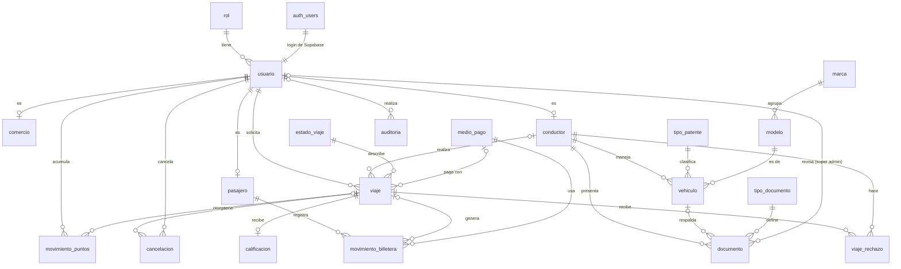

# BellaVista Remis — Base de datos y correcciones

Motor: **PostgreSQL 14+ en Supabase**. Script completo en `database/schema.sql`, probado en un PostgreSQL real (tablas, permisos y funciones).
Hoy la app guarda todo en memoria (`js/storage.js`); este diseño es el que corresponde al pasar a un servidor real.

## Datos del proyecto

| Dato | Valor |
|---|---|
| Servicio | Supabase (PostgreSQL 17), plan gratis |
| Proyecto | bellavista-remis · región São Paulo |
| Dirección | (la dirección de tu proyecto de Supabase) |
| Contenido | 22 tablas · 45 funciones · seguridad por usuario (RLS) en todas las tablas |
| Super administrador | dueno@bellavistaremis.com |
| Sitios | App principal (pasajeros, choferes, supermercados) y sitio aparte del super admin, los dos sobre esta misma base |

## 1. Diagrama de relaciones

## 2. Tablas

### Catálogos: rol · estado_viaje · medio_pago · marca · modelo · tipo_patente · tipo_documento · tarifa · configuracion

| Tabla | Columnas | Clave primaria | Claves foráneas | Para qué sirve |
|---|---|---|---|---|
| rol | id, nombre | id | — | pasajero, conductor, comercio, admin, superadmin |
| estado_viaje | id, codigo, nombre | id | — | buscando, asignado, camino, llego, curso, finalizado, cancelado, programado |
| medio_pago | id, nombre | id | — | Billetera, Efectivo, Puntos, Mercado Pago, Ualá, Transferencia, Tarjeta |
| marca | id, nombre | id | — | Fiat, Renault, Chevrolet… |
| modelo | id, marca_id, nombre | id | marca_id → marca | Siena, Sandero, Onix… (único por marca) |
| tipo_patente | id, nombre | id | — | Mercosur (AB 123 CD) o Anterior (ABC 123) |
| tipo_documento | id, codigo, nombre, aplica_a, pide_vencimiento, pide_numero, pide_entidad, obligatorio | id | — | Qué documentación se exige al chofer (foto del auto, patente, licencia, seguro, VTV, cédula, habilitación). El super admin elige cuáles son obligatorias |
| tarifa | id, precio_100m, minima, base, por_km, recargo_nocturno_pct, recargo_rural_pct, vigente_desde | id | — | Historial de tarifas; la vigente es la más reciente |
| configuracion | clave, valor | clave | — | Ajustes: puntos por viaje, metas de puntos, modo de cargas simuladas |

### usuario (todas las personas y comercios que entran a la app)

| Columna | Tipo | Clave / restricción | Descripción |
|---|---|---|---|
| id | UUID | PK, FK → auth.users | Mismo identificador que el login de Supabase |
| rol_id | SMALLINT | FK → rol, NOT NULL | Pasajero, conductor, comercio o admin |
| nombre | VARCHAR(80) | NOT NULL | Nombre (en comercios, el responsable) |
| apellido | VARCHAR(80) | NOT NULL, default '' | Apellido |
| dni | VARCHAR(12) | — | Solo conductores |
| telefono | VARCHAR(30) | NOT NULL | Teléfono |
| email | VARCHAR(120) | UNIQUE, NOT NULL | Usuario de ingreso |
| foto | TEXT | — | Foto de perfil |
| estado | VARCHAR(10) | CHECK activo/bloqueado | Bloqueo por el administrador |
| creado_en | TIMESTAMPTZ | NOT NULL | Fecha de alta |

### Especializaciones de usuario (relación 1 a 1)

| Tabla | Columnas | PK | FK | Descripción |
|---|---|---|---|---|
| pasajero | usuario_id, saldo, puntos, viajes_gratis | usuario_id | usuario_id → usuario | Billetera y puntos del pasajero |
| comercio | usuario_id, nombre_local, direccion, lat, lng | usuario_id | usuario_id → usuario | Origen fijo de los pedidos del supermercado |
| conductor | id, usuario_id, licencia, estado_aprobacion, disponible, puntos, bonos | id | usuario_id → usuario (UNIQUE) | Datos del chofer; licencia única |
| vehiculo | id, conductor_id, modelo_id, tipo_patente_id, anio, asientos, color, patente | id | conductor_id → conductor; modelo_id → modelo; tipo_patente_id → tipo_patente | Patente única |

### Documentación del chofer

| Tabla | Columnas | PK | FK | Descripción |
|---|---|---|---|---|
| documento | id, conductor_id, vehiculo_id, tipo_documento_id, numero, entidad, vence_el, archivo, estado, observacion, revisado_por, revisado_en, creado_en | id; UNIQUE (conductor_id, tipo_documento_id) | conductor_id → conductor; vehiculo_id → vehiculo (vacío en la licencia); tipo_documento_id → tipo_documento; revisado_por → usuario | Cada documento que sube el chofer (foto, N° de póliza, aseguradora, vencimiento) y su revisión: pendiente, aprobado o rechazado con motivo |

**Regla de habilitación:** un chofer puede recibir viajes solo si el super admin lo aprobó **y** tiene aprobados y vigentes (no vencidos) todos los documentos obligatorios. Si el seguro, la VTV o la licencia vencen, queda inhabilitado automáticamente, sin que nadie tenga que hacer nada. Al renovar un documento vuelve a "pendiente" hasta que se revise.

### Viajes

| Tabla | Columnas | PK | FK | Descripción |
|---|---|---|---|---|
| viaje | id, codigo, solicitante_id, conductor_id, estado_id, cliente_nombre, cliente_telefono, origen_direccion, origen_lat, origen_lng, destino_direccion, destino_lat, destino_lng, distancia_m, cantidad_pasajeros, observaciones, tarifa, medio_pago_id, programado_para, creado_en, finalizado_en | id (codigo UNIQUE) | solicitante_id → usuario; conductor_id → conductor (NULL hasta aceptar); estado_id → estado_viaje; medio_pago_id → medio_pago | Un pedido de remis |
| viaje_rechazo | viaje_id, conductor_id, creado_en | (viaje_id, conductor_id) | viaje_id → viaje; conductor_id → conductor | Choferes que rechazaron un viaje (N a M) |
| cancelacion | id, viaje_id, usuario_id, motivo, creado_en | id | viaje_id → viaje; usuario_id → usuario | Quién canceló y por qué |
| calificacion | id, viaje_id, estrellas, comentario, creado_en | id | viaje_id → viaje (UNIQUE) | Una calificación (1 a 5) por viaje |

### Control

| Tabla | Columnas | PK | FK | Descripción |
|---|---|---|---|---|
| auditoria | id, usuario_id, accion, detalle, creado_en | id | usuario_id → usuario (si se borra el usuario queda vacío) | Registro de quién hizo qué: aprobar choferes, bloquear, cambiar tarifas y ajustes, ascender o quitar administradores |

### Billetera y puntos

| Tabla | Columnas | PK | FK | Descripción |
|---|---|---|---|---|
| movimiento_billetera | id, usuario_id, viaje_id, tipo (carga/viaje), monto, detalle, medio_pago_id, creado_en | id | usuario_id → pasajero; viaje_id → viaje (NULL en cargas); medio_pago_id → medio_pago | Cargas de dinero y gastos en viajes |
| movimiento_puntos | id, usuario_id, viaje_id, puntos (+/−), motivo, creado_en | id | usuario_id → usuario; viaje_id → viaje | Historial de puntos ganados y canjeados |

## 3. Relaciones (cardinalidad)

| Relación | Cardinalidad | Cómo se implementa |
|---|---|---|
| rol → usuario | 1 a N | usuario.rol_id |
| usuario → pasajero / comercio / conductor | 1 a 0..1 | La PK de pasajero y comercio es la FK a usuario; conductor.usuario_id es UNIQUE |
| conductor → vehiculo | 1 a N | vehiculo.conductor_id |
| tipo_patente → vehiculo | 1 a N | vehiculo.tipo_patente_id |
| conductor → documento | 1 a N | documento.conductor_id (una versión por tipo) |
| tipo_documento → documento | 1 a N | documento.tipo_documento_id |
| vehiculo → documento | 1 a 0..N | documento.vehiculo_id (vacío en la licencia) |
| usuario (super admin) → documento | 1 a 0..N | documento.revisado_por |
| marca → modelo → vehiculo | 1 a N, 1 a N | modelo.marca_id, vehiculo.modelo_id |
| usuario → viaje (solicitante) | 1 a N | viaje.solicitante_id |
| conductor → viaje | 1 a N (opcional) | viaje.conductor_id |
| viaje ↔ conductor (rechazos) | N a M | Tabla intermedia viaje_rechazo |
| viaje → calificacion | 1 a 0..1 | calificacion.viaje_id UNIQUE |
| viaje → cancelacion | 1 a 0..N | cancelacion.viaje_id |
| pasajero → movimiento_billetera | 1 a N | movimiento_billetera.usuario_id |
| usuario → movimiento_puntos | 1 a N | movimiento_puntos.usuario_id |

## 4. Seguridad y funciones

**Funciones del chofer para su documentación:** `tipos_documento` (qué se exige), `subir_documento` (sube o renueva uno; rechaza fotos que no sean imágenes y documentos vencidos) y `mis_documentos` (estado de cada uno, con aviso de vencimiento).

La app **no escribe directo en las tablas**: solo lee lo suyo (RLS) y llama a funciones que validan todo en el servidor.

| Función | Quién la usa | Qué hace |
|---|---|---|
| registrar_perfil | cualquier cuenta nueva | Crea usuario y su perfil (nunca admin) |
| mi_perfil, mis_viajes, mis_movimientos, tarifa_vigente | todos | Lectura de lo propio; el chofer ve además los pedidos abiertos |
| pedir_viaje | pasajero, comercio | **Calcula la tarifa en el servidor** (cuadras de 100 m × precio) y reserva el viaje gratis si corresponde |
| aceptar_viaje, rechazar_viaje | chofer aprobado | Toma o rechaza un pedido (un solo chofer puede tomarlo) |
| avanzar_viaje | chofer del viaje | Cambia el estado en orden; al finalizar cobra (billetera, efectivo o puntos) y da puntos |
| cancelar_viaje | pasajero o chofer | Cancela; devuelve el viaje gratis o vuelve a buscar chofer |
| calificar_viaje | pasajero | Una vez por viaje; 5 estrellas dan puntos extra al chofer |
| set_disponible | chofer | Conectado / desconectado |
| cargar_saldo | pasajero | **Simulada** mientras `carga_simulada = true` |
| ranking | chofer, admin | Ranking; solo el admin ve lo ganado |
| admin_listado, aprobar_conductor, bloquear_usuario, guardar_tarifa | admin | Panel de administración |

### Super administrador (el dueño)

| Función | Qué hace |
|---|---|
| superadmin_conductores | Lista de choferes con su estado, documentos aprobados, por revisar y vencidos |
| superadmin_conductor | Ficha completa de un chofer: datos, vehículo, patente y fotos de cada documento |
| revisar_documento | Aprueba o rechaza un documento (el rechazo exige un motivo) |
| aprobar_conductor | **Solo el super admin.** Exige todos los documentos obligatorios aprobados y vigentes |
| guardar_tipo_documento | Elige qué documentos son obligatorios |
| superadmin_resumen | Recaudación total y del mes, viajes, usuarios por tipo, choferes por aprobar, saldo en billeteras |
| superadmin_admins | Lista del equipo de administradores |
| ascender_admin | Convierte en administrador a una cuenta de pasajero ya registrada (por mail) |
| quitar_admin | Le saca el acceso a un administrador común |
| ver_ajustes, guardar_ajuste | Puntos, metas y modo de cargas (con validación y solo valores permitidos) |
| ver_auditoria | Historial de acciones |

El super administrador puede hacer también todo lo del administrador. Un administrador común **no** puede usar estas funciones (probado). El primer super administrador se crea una sola vez desde el SQL Editor (ver `bellavista-superadmin/LEEME.md`).

Probado: un pasajero no puede cambiarse el saldo, los puntos ni crear viajes a mano; un usuario bloqueado no puede pedir ni cargar; un chofer no aprobado no puede aceptar viajes; solo el admin accede al listado.

## 5. Normalización

| Forma normal | Problema en el modelo actual de la app | Solución aplicada |
|---|---|---|
| 1FN (valores atómicos, sin listas) | `trip.rejectedBy` guarda una lista de conductores dentro del viaje | Tabla `viaje_rechazo` (N a M) |
| 2FN (sin dependencias parciales) | Las tablas con clave compuesta solo tienen datos que dependen de toda la clave | `viaje_rechazo` tiene solo la clave compuesta y la fecha; el resto usa clave simple |
| 3FN (sin dependencias transitivas) | `vehicles` repetía la marca junto al modelo (modelo → marca) | Tablas `marca` y `modelo` |
| 3FN | `trips` copiaba `nombrePasajero` y `telefono` del usuario | Se eliminaron; se obtienen por `solicitante_id`. Solo se guardan `cliente_nombre/telefono` en pedidos de comercio, donde el cliente no tiene cuenta |
| 3FN | `ratings` repetía `driverId`, que ya se deduce del viaje | `calificacion` solo referencia `viaje_id` |
| 3FN | `cancellations.by` ('pasajero'/'conductor') se deduce del rol de quien canceló | Se eliminó; se consulta por `usuario.rol_id` |
| 3FN | `drivers.rating` y `ratingCount` son datos calculables | Se eliminaron; vista `vw_calificacion_conductor` |
| 3FN | Estados, medios de pago y roles escritos como texto repetido | Tablas de catálogo con FK |
| 3FN | `users` mezclaba datos de pasajero, comercio y conductor | Especialización en `pasajero`, `comercio` y `conductor` |
| 3FN | El tipo de patente y los documentos que se exigen son valores repetidos de un conjunto fijo | Catálogos `tipo_patente` y `tipo_documento` |
| 3FN | Seguro, VTV, licencia y fotos serían columnas sueltas y repetidas en `vehiculo` o `conductor` | Tabla `documento` (una fila por documento, con su vencimiento y revisión) |
| 3FN | El N° de licencia y la patente aparecerían dos veces (dato y documento) | Se guardan una sola vez en `conductor` y `vehiculo`; el documento solo guarda foto y vencimiento |

**Desnormalizaciones deliberadas** (por rendimiento, se pueden verificar con una consulta):
`pasajero.saldo`, `pasajero.puntos`, `viajes_gratis`, `conductor.puntos` y `bonos` son totales que también se podrían calcular sumando `movimiento_billetera` y `movimiento_puntos`. Se guardan para no recalcular en cada pantalla.

## 6. Equivalencia con la app (modo demostración → base de datos)

| Estructura en `js/storage.js` | Tabla(s) nueva(s) |
|---|---|
| `DB.users` | usuario + pasajero / comercio |
| `DB.drivers` | conductor |
| `DB.vehicles` | vehiculo + modelo + marca |
| `DB.trips` | viaje (+ viaje_rechazo) |
| `DB.movements` | movimiento_billetera |
| `DB.ratings` | calificacion |
| `DB.cancellations` | cancelacion |
| `DB.tariffs` | tarifa |
| contadores de puntos en usuario y conductor | movimiento_puntos (historial) |

## 7. Correcciones realizadas en la app

| Tema | Qué estaba mal | Qué se corrigió |
|---|---|---|
| Diseño en PC | La app se veía como en el celular | `css/desktop.css`, solo desde 1024 px; el celular no cambia |
| Código sobrante | Archivo `maps.js` vacío, estilos duplicados o sin uso | Se eliminaron |
| Foto de perfil | Se elegía en el registro pero no se guardaba | Se guarda (achicada) y se muestra en toda la app |
| Pedido de remis | 4 pasos pidiendo nombre y teléfono a usuarios ya registrados | 2 pasos: recorrido y confirmar; los datos salen de la cuenta |
| Precio del viaje | El precio mostrado y el cobrado se calculaban al azar por separado | Lo calcula el servidor: cuadras de 100 m × precio vigente |
| Recaudación | Contaba los viajes gratis como cobrados | Los excluye |
| Aprobación de choferes | La hacía el administrador sin revisar el vehículo | La hace solo el super admin, revisando cada documento |
| Usuarios bloqueados | Podían seguir pidiendo viajes y cargando saldo | Se les bloquea en el servidor |
| Contraseñas | Se guardaban en texto plano en la demo | Las guarda cifradas el login de Supabase |
| Fotos | Podían contener código malicioso | La base solo acepta imágenes reales |
| Panel del super admin | Columna angosta y poco aprovechada | Menú lateral en PC, barra inferior en celular, sin barras horizontales |
| Tarifa | Estimación al azar | $ por cada 100 m con Google Maps (precio editable por el super admin) |

## 8. Pendientes para pasar a producción

| Tema | Detalle |
|---|---|
| Confirmación por mail | Apagar "Confirm email" en Supabase (Authentication → Sign In / Providers → Email). El servicio de mail gratis de Supabase casi no envía y no sirve para producción. Si más adelante se quieren códigos por mail, hace falta un servicio de envío propio (por ejemplo Resend, con un dominio propio) |
| Proyecto pausado | El plan gratis de Supabase pausa los proyectos sin uso. Se reactiva con "Restore project". Para un servicio diario conviene el plan Pro |
| Pagos reales | La carga de saldo es de prueba. Antes de cobrar de verdad: super admin → Ajustes → "Reales", y confirmar el pago con Mercado Pago o Ualá desde un servidor |
| Clave de Google Maps | Cargarla en `js/config.js` de la app (mapa y tarifa por distancia) |
| Administrador común | Todavía no tiene panel propio: las tareas de administración se hacen desde el sitio del super admin |
| Recuperar contraseña | No está conectado: hoy se restablece a mano desde Supabase |
| Legales | Términos de uso y política de privacidad (se guardan ubicación, teléfonos y fotos de documentos) |

## 9. Puesta en marcha en Supabase

| Paso | Estado | Qué hacer |
|---|---|---|
| 1 | Hecho | Proyecto creado (región São Paulo) |
| 2 | Hecho | `schema.sql` cargado: tablas, funciones, seguridad y datos iniciales |
| 3 | Hecho | Usuario super admin creado y con rol `superadmin` |
| 4 | Pendiente | Authentication → Providers → Email: apagar "Confirm email" |
| 5 | Pendiente | Subir los dos sitios a Netlify (cada carpeta como un sitio distinto) |
| 6 | Pendiente | Probar el circuito: registrar un chofer con sus documentos, aprobarlo desde el super admin, pedir y completar un viaje |
| 7 | Pendiente | Cargar la clave de Google Maps en la app |

## 10. Quién hace qué (roles)

| Rol | Qué hace |
|---|---|
| Usuario (pasajero) | Pide remises, usa la billetera y junta puntos |
| Comercio / supermercado | Tiene una pantalla para que sus clientes pidan remis |
| Chofer | Se registra con su vehículo y su documentación; recibe viajes solo si está habilitado |
| Administrador | Operación diaria: bloquea usuarios y cambia tarifas |
| **Super administrador** | **Aprueba o rechaza a los choferes, revisa la documentación y el vehículo, maneja administradores, ajustes y auditoría** |

## 11. Diagramas entidad-relación

Están en `DER_BellaVista_Remis.pdf` (todos los diagramas) y `DER_general.png`, listos para presentar:
general (22 tablas) y cinco módulos: usuarios y vehículos, documentación del chofer, viajes, billetera y puntos, control y ajustes.
